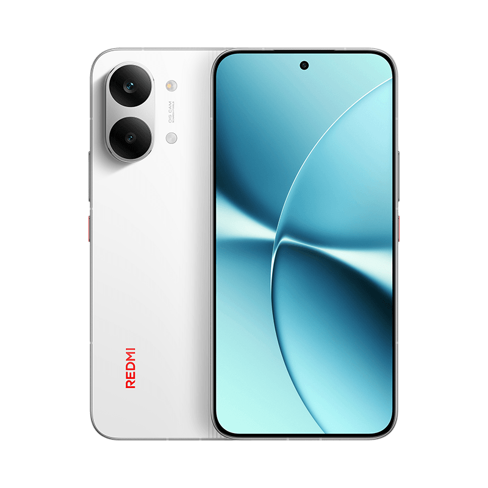

Device tree for Xiaomi dash
=============================================

EN | [简体中文](README_zh.md)

The Redmi Turbo 5 Max is a ~~performance flagship powered by a nerfed previous-generation MTK flagship chip~~ proper MTK performance flagship with a current-generation chip running at full strength. Specs below.

There's no POCO variant, so this tree targets the China model. Currently, only LineageOS 24.0 is supported.

## Features

- [x] Cellular / VoLTE
- [x] Wi-Fi
- [x] Bluetooth
- [x] NFC
- [x] Cameras
- [x] GPS
- [x] USB OTG
- [x] Dual camera ring lights
- [x] Fingerprint
- [x] Automatic brightness
- [x] Dolby Atmos
- [x] Dolby Vision
- [x] App scheduling from HyperOS
- [x] Always-on display
- [x] SELinux enforcing
- [x] Charging
  - Fast charging
  - Reverse charging
  - Charge limit
  - Bypass charging (see its description for details)
- [x] Suspend and wake
  - Lift to wake / put down to sleep
  - Double tap to wake
  - Screen attention
- [x] Encryption / decryption
- [x] Face unlock

## Device specifications

Component | Specification
---------:|:---------------------------------------------------------
SoC       | MediaTek ~~proper current-generation flagship SoC~~ Dimensity 9500s (MT6991Z/ECZB)
CPU       | Octa-core: 1x 3.73 GHz Cortex-X925 & 3x 3.30 GHz Cortex-X4 & 4x 2.40 GHz Cortex-A720
GPU       | Immortalis-G925 MC12
RAM       | 12/16 GB LPDDR5X ~~an investment!~~
Storage   | 256/512 GB / 1 TB UFS 4.1 ~~Waiting for a price drop? SURPRISE! Prices went up. 🤡~~
Shipped OS | ~~it works!~~ Android 16 (HyperOS 3)
Battery   | 9000 mAh ~~Artificially nerfed capacity~~ silicon-carbon battery, 100W wired fast charging ~~You'd be mad if you saw the actual charging curve~~, 27W wired reverse charging ~~A neat trick, sadly nerfed by physics~~
Display   | 6.83" AMOLED, 1280 x 2772 (1.5K), 120 Hz, 3840 Hz PWM dimming, Dolby Vision / HDR10+ / HDR Vivid, 3500 nits peak brightness
Rear cameras | 50 MP f/1.5 main (OIS) + 8 MP f/2.2 ultrawide ~~as long as it scans QR codes~~
Front camera | 20 MP f/2.2
Dimensions | 163 x 77.9 x 8.2 mm, 219 g
Ingress protection | IP66 / IP68 / IP69 / IP69K ~~IP rating: "Trust me bro"~~
Biometrics | Ultrasonic under-display fingerprint sensor
Connectivity | Wi-Fi 7, ~~Evolution, but backwards~~ Bluetooth 5.4, NFC, ~~MVP~~ IR blaster, USB 2.0 ~~Classic artificial segmentation~~

## Credits

- [AOSPA](https://github.com/AOSPA)
- [PixelOS](https://github.com/PixelOS-AOSP)
- [WeiguangTWK](https://github.com/WeiguangTWK) for the LineageOS spoofing patch
- Some reference material from [xiaomi-dash](https://github.com/xiaomi-dash)
- My wallet
- Everyone in the community

## License

[Apache-2.0](LICENSE)

## Device picture

